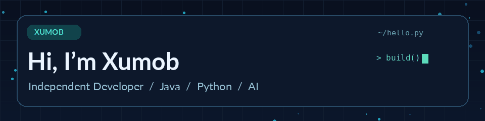

<div align="center">



### 你好，我是 Xumob 👋

**独立开发者 · Java / Python · AI 应用探索者**

把想法写成代码，把代码变成真正能用的产品。

[](https://www.xumob.cn)
[](https://github.com/XUMOB3748)

</div>

---

### 🧑‍💻 About Me / 关于我

- 🚀 一名热爱创造与折腾的**个人开发者**，关注实用、有趣、可持续迭代的产品。
- ☕ 使用 **Java / Spring Boot** 开发后端服务与 API。
- 🐍 使用 **Python / FastAPI** 探索 AI 服务与 Web 应用。
- 🤖 持续学习和实践 **LLM、RAG、Embedding、Agent、工具调用与流式响应**。
- 🧩 对**开发者工具、项目工程化、开源与可定制软件**充满兴趣。
- 🌐 更多关于我：**[www.xumob.cn](https://www.xumob.cn)**

> **Code. Build. Explore. Repeat.**

### 🛠️ Tech Stack / 技术栈

<div align="center">


</div>

### 🔭 What I'm Exploring / 最近在探索

```text
Developer Journey
├── Backend Engineering
│   ├── Java · Spring Boot
│   └── Python · FastAPI
├── AI Applications
│   ├── LLM APIs · Streaming
│   ├── RAG · Vector Search
│   └── Agent · Tool Calling
└── Indie Hacking
    ├── Developer Tools
    └── Open Source & Customization
```

### 📊 GitHub / 开发足迹

<div align="center">


</div>

### ✨ A Little More / 一点想法

> 软件不仅是代码，更是不断发现问题、解决问题的过程。  
> Keep shipping. Keep learning. Keep building.

<div align="center">

**Thanks for visiting! / 感谢访问** 💚

[🌐 个人网站](https://www.xumob.cn) · [💻 GitHub](https://github.com/XUMOB3748)


</div>
